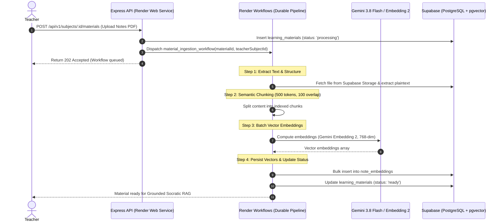
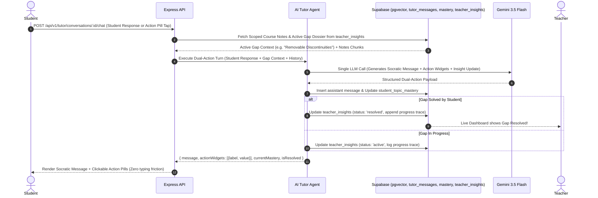
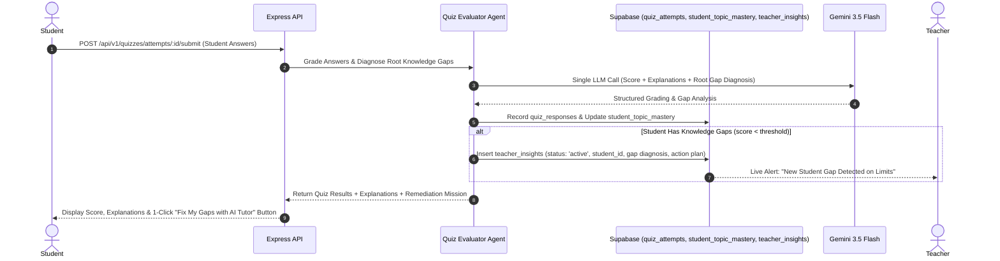

# ThinkFirst — System Architecture Document

**Project**: ThinkFirst  
**Team**: Odysseus  
**Track**: Agentic AI · RealmHack 2026  
**Document Version**: 1.0.0  

---

## 1. High-Level Architectural Overview

ThinkFirst is built upon a hybrid **Agentic Intelligence & Deterministic State Architecture**. While modern Large Language Models excel at semantic comprehension, natural language tutoring, and qualitative evidence extraction, they are fundamentally probabilistic, non-reproducible, and prone to calibration drift. Therefore, ThinkFirst strictly enforces this governing principle:

> **"Agents reason over evidence; deterministic services maintain canonical learning state."**

```
┌────────────────────────────────────────────────────────────────────────────────────────┐
│                                   01 USERS                                             │
│  ┌───────────────────┐    ┌───────────────────┐    ┌───────────────┐   ┌─────────────┐ │
│  │ Superadmin (Us)   │───▶│   College Admin   │───▶│    Teacher    │──▶│   Student   │ │
│  │ (Creates Colleges)│    │(Teachers/Students)│    │(Class/Subjects)   │(Study/Tutor)│ │
│  └───────────────────┘    └───────────────────┘    └───────────────┘   └─────────────┘ │
└────────────┬────────────────────────┬──────────────────────┬──────────────────┬────────┘
                │                           │                           │
┌───────────────┼───────────────────────────┼───────────────────────────┼────────────────┐
│               ▼                           ▼                           ▼                │
│       ┌────────────────────────────────────────────────────────────────────────┐       │
│       │                 02 APPLICATION LAYER (Next.js Web App)                 │       │
│       │          [Teacher Dashboard]                  [Student Study App]      │       │
│       └───────────────────────────────────┬────────────────────────────────────┘       │
│                                           │ (HTTP / SSE / REST)                        │
│       ┌───────────────────────────────────▼────────────────────────────────────┐       │
│       │                    Node.js + TypeScript API Gateway                    │       │
│       │  [Auth/RBAC]   [Classes]   [Curriculum]   [Notes]   [Quizzes] [Tutor]  │       │
│       └───────────────────────────────────┬────────────────────────────────────┘       │
└───────────────────────────────────────────┼────────────────────────────────────────────┘
                                            │
┌───────────────────────────────────────────┼────────────────────────────────────────────┐
│ 03 AGENTIC INTELLIGENCE — MASTRA ORCHESTRATION (Gemini 3.8 Flash)                      │
│                                           │                                            │
│   ┌─────────────────────┐   ┌─────────────┴───────┐   ┌───────────────────────┐        │
│   │  Curriculum Agent   │   │ Notes & Retrieval   │   │      Quiz Agent       │        │
│   │ (Syllabus Structure)│   │  (pgvector Embed)   │   │  (Targeted Problems)  │        │
│   └──────────┬──────────┘   └─────────────┬───────┘   └───────────┬───────────┘        │
│              │                            │                       │                    │
│   ┌──────────┴──────────┐   ┌─────────────┴───────┐   ┌───────────┴───────────┐        │
│   │   Evaluator Agent   │   │     Tutor Agent     │   │     Insight Agent     │        │
│   │ (Evidence Extractor)│   │ (Socratic Dialogue) │   │ (Classroom Analytics) │        │
│   └──────────┬──────────┘   └─────────────┬───────┘   └───────────┬───────────┘        │
└──────────────┼────────────────────────────┼───────────────────────┼────────────────────┘
               │ Structured Evidence Tokens │ Tutor Response        │ Aggregated Signals
┌──────────────┼────────────────────────────┴───────────────────────┼────────────────────┐
│              ▼                                                    ▼                    │
│ 04 LEARNING STATE — DETERMINISTIC SERVICES                                             │
│   ┌─────────────────────────────────────────────────────────────────────────────────┐  │
│   │                          Deterministic Mastery Engine                           │  │
│   │  - Evaluates structured evidence confidence & weights                           │  │
│   │  - Updates Student Knowledge Snapshot (JSONB) deterministically                 │  │
│   │  - Applies decay and prerequisite chain gating                                  │  │
│   └───────────────────────────────────────┬─────────────────────────────────────────┘  │
└───────────────────────────────────────────┼────────────────────────────────────────────┘
                                            │ Persist canonical state
┌───────────────────────────────────────────▼────────────────────────────────────────────┐
│ 05 DATA LAYER — PostgreSQL / Supabase                                                  │
│   - Curriculum & Syllabus Tree                                                         │
│   - pgvector: Class-Scoped Teacher Note Embeddings                                     │
│   - Quiz Data & Student Submissions                                                    │
│   - Canonical Knowledge Snapshots (JSONB) & Learning Evidence Event Log                │
│   - Multi-tenant Row-Level Security (RLS) Policies                                     │
└────────────────────────────────────────────────────────────────────────────────────────┘
```

---

## 2. System Layers & Detailed Component Design

### 2.1 Layer 1: Presentation Layer
- **Framework**: Next.js 15 (App Router) + React Server Components.
- **Styling & UI**: Tailwind CSS v4 + `shadcn/ui` component library.
- **Key Views**:
  - *Teacher Studio*: Syllabus and notes upload, curriculum tree editor, and real-time class learning gap visualizations.
  - *Student Study Hub*: Interactive topic tree with real-time mastery dials, Socratic chat interface with streaming responses, and personalized quiz runner.
  - *Admin Portal*: User roster, role assignment, and classroom provisioning.

### 2.2 Layer 2: Backend API & Durable Workflows (Render Platform)
- **Runtime**: Node.js 20+ with strict TypeScript.
- **Web Service Gateway (Render Web Service)**: Express.js configured with a modular, domain-driven structure handling fast requests, authentication, and real-time Server-Sent Events (SSE) streaming for the Socratic Tutor.
- **Asynchronous Execution (Render Workflows)**: Multi-step, durable background tasks for heavy AI operations (PDF text extraction, semantic chunking, batch Gemini vector embeddings, and classroom insight synthesis). Render Workflows provide automated step retries, state persistence, and scale-to-zero compute.
- **Middleware Pipeline**:
  ```
  Request 
    ──▶ [CORS & Security Headers] (Helmet, CORS)
    ──▶ [Rate Limiter] (Express-Rate-Limit)
    ──▶ [Auth Middleware] (Supabase JWT Verification)
    ──▶ [RBAC Middleware] (Role verification: Superadmin/Admin/Teacher/Student)
    ──▶ [Subject Scope Middleware] (Tenant validation & enrollment check)
    ──▶ [Request Validation Middleware] (Zod schema parser)
    ──▶ [Controller Layer]
    ──▶ [Service / Render Workflow Dispatcher]
    ──▶ [Response Formatter Utils]
    ──▶ [Global Error Handler Middleware]
  ```

### 2.3 Layer 3: Agentic Intelligence Layer (Collaborative Agent Architecture)
Orchestrated using the **Google Gemini SDK** (Gemini 3.5 Flash / Flash Lite) with cost-efficient structured dual-action outputs:

| Component / Agent | Role & Type | Primary Action / Responsibility | Output & State Impact |
|---|---|---|---|
| **1. Quiz Generator** | Traditional LLM Service | Generates targeted diagnostic questions from course notes & syllabus | Multi-format diagnostic quiz (MCQs & open conceptual prompts) |
| **2. Quiz Evaluator Agent** | Autonomous Evaluator Agent | Evaluates student answers, calculates mastery delta, and **autonomously diagnoses knowledge gaps** | Emits grading feedback AND **automatically inserts/updates `teacher_insights`** (`status: 'active'`, gap diagnosis, student reasoning trace) |
| **3. AI Tutor Agent** | Personal Agent & Teacher's Bridge | Delivers **Interactive Chat with Action Widgets (Method 2)** targeting missing knowledge | Socratic message + clickable action pills/options; **updates `student_topic_mastery` and transitions `teacher_insights` to `'resolved'`** |
| **4. Teacher Insights** | Real-time Pedagogical Dossier | Aggregates classroom & individual student gap resolution traces | Live Teacher Dashboard: Active vs. Resolved gaps, student progress traces, and actionable lecture talking points |

*Note: Document and notes extraction is handled via the deterministic **Multimodal OCR & Document Extraction Pipeline** (`utils/ocr.util.ts`), and curriculum structuring is handled via deterministic bulk hierarchical import (`POST /bulk`), eliminating non-deterministic LLM variance for syllabus ingestion.*

### 2.4 Layer 4: Deterministic Services Layer
- **Mastery Engine**:
  - Receives structured evidence tokens emitted by the Evaluator Agent.
  - Mathematical updates:
    $$\Delta M = \eta \cdot (E_{\text{score}} - M_{\text{current}}) \cdot C_{\text{weight}}$$
    where $\eta$ is the learning rate, $E_{\text{score}} \in [0, 1]$ is the verified evidence score, and $C_{\text{weight}}$ is the confidence multiplier.
  - Updates the student's canonical JSONB knowledge snapshot.
  - Calculates decay over time for unreinforced prerequisite concepts.
- **Classroom Scoping Service**:
  - Guarantees that no student vector query or mastery aggregation can ever leak data outside its target `classroom_id`.

### 2.5 Layer 5: Data Layer (Supabase PostgreSQL + pgvector)
- **Relational Data**: Classrooms, memberships, curriculum nodes, quiz records, and chat logs.
- **Vector Storage**: `note_embeddings` table with 768-dimensional Gemini Embedding 2 vectors, indexed via `HNSW` using cosine distance (`vector_cosine_ops`).
- **Document Storage**: Canonical student mastery trees stored as JSONB for schema flexibility and sub-millisecond retrieval.
- **Row-Level Security (RLS)**: Enforced directly at the database level to ensure impenetrable multi-tenancy.

---

## 3. End-to-End Workflow Sequence Diagrams

### 3.1 Flow A: Teacher Syllabus & Notes Ingestion (Render Workflows)



### 3.2 Flow B: Student Interactive Socratic Chat with Action Widgets (Method 2)



### 3.3 Flow C: Quiz Evaluation & Automated Gap Diagnosis



---

## 4. Modular Codebase Architecture (Backend)

The backend implements a **Modular Monolith** pattern organized strictly by business domain, preventing spaghetti dependencies:

```
backend/
├── src/
│   ├── config/              # Environment variables, database configs, Supabase client
│   │   ├── env.ts
│   │   ├── supabase.ts
│   │   └── mastra.ts
│   │
│   ├── middlewares/         # Global & route-level middlewares
│   │   ├── auth.middleware.ts             # Supabase JWT authentication
│   │   ├── role.middleware.ts             # RBAC enforcement (admin, teacher, student)
│   │   ├── classroomScope.middleware.ts   # Multi-tenant classroom isolation
│   │   ├── validation.middleware.ts       # Zod schema validation
│   │   ├── errorHandler.middleware.ts     # Centralized error management
│   │   └── rateLimit.middleware.ts        # Abuse protection
│   │
│   ├── utils/               # Shared utilities for repeated code patterns
│   │   ├── response.util.ts               # Standard API response envelopes (sendSuccess, sendError)
│   │   ├── vector.util.ts                 # pgvector query builders & cosine similarity
│   │   ├── errors.util.ts                 # Custom AppError hierarchy (BadRequest, NotFound, Forbidden)
│   │   ├── logger.util.ts                 # Structured logging
│   │   └── textChunker.util.ts            # Text and markdown chunking utility
│   │
│   ├── modules/             # Domain-specific feature modules
│   │   ├── auth/            # Auth profile hooks & user management
│   │   │   ├── auth.controller.ts
│   │   │   ├── auth.service.ts
│   │   │   ├── auth.routes.ts
│   │   │   └── auth.schemas.ts
│   │   │
│   │   ├── classrooms/      # Classroom creation, enrollment, student roster
│   │   │   ├── classrooms.controller.ts
│   │   │   ├── classrooms.service.ts
│   │   │   ├── classrooms.routes.ts
│   │   │   └── classrooms.schemas.ts
│   │   │
│   │   ├── curriculum/      # Syllabus parsing & curriculum node tree
│   │   │   ├── curriculum.controller.ts
│   │   │   ├── curriculum.service.ts
│   │   │   ├── curriculum.routes.ts
│   │   │   └── curriculum.schemas.ts
│   │   │
│   │   ├── notes/           # Teacher notes upload, chunking & vector RAG
│   │   │   ├── notes.controller.ts
│   │   │   ├── notes.service.ts
│   │   │   ├── notes.routes.ts
│   │   │   └── notes.schemas.ts
│   │   │
│   │   ├── quizzes/         # Quiz generation, submission & evaluation
│   │   │   ├── quizzes.controller.ts
│   │   │   ├── quizzes.service.ts
│   │   │   ├── quizzes.routes.ts
│   │   │   └── quizzes.schemas.ts
│   │   │
│   │   ├── tutor/           # Socratic chat sessions & streaming responses
│   │   │   ├── tutor.controller.ts
│   │   │   ├── tutor.service.ts
│   │   │   ├── tutor.routes.ts
│   │   │   └── tutor.schemas.ts
│   │   │
│   │   ├── mastery/         # Deterministic Mastery Engine & state snapshots
│   │   │   ├── mastery.controller.ts
│   │   │   ├── mastery.engine.ts
│   │   │   ├── mastery.service.ts
│   │   │   ├── mastery.routes.ts
│   │   │   └── mastery.schemas.ts
│   │   │
│   │   └── analytics/       # Aggregated teacher insights & gap detection
│   │       ├── analytics.controller.ts
│   │       ├── analytics.service.ts
│   │       ├── analytics.routes.ts
│   │       └── analytics.schemas.ts
│   │
│   ├── agents/              # 4 Core AI Agents & Gemini Client
│   │   ├── gemini.client.ts     # Resilient Gemini API client with fallback & retry logic
│   │   ├── quiz.agent.ts        # Dynamic diagnostic quiz generator
│   │   ├── evaluator.agent.ts   # Free response & reasoning evaluator
│   │   ├── tutor.agent.ts       # Grounded Socratic tutoring dialogue & streaming
│   │   └── insight.agent.ts     # Class diagnostic insight synthesizer
│   │
│   ├── utils/ocr.util.ts    # Multimodal OCR (PDF/images) & document text extractor
│   │
│   ├── app.ts               # Express application initialization & middleware assembly
│   └── server.ts            # HTTP server bootstrap & graceful shutdown
│
├── package.json
└── tsconfig.json
```

---

## 5. Security & Isolation Architecture

1. **Classroom Multi-Tenancy**:
   - Every database query touching learning materials or student state is hard-filtered by `classroom_id`.
   - The `classroomScope.middleware.ts` asserts that the authenticated user is an active member or instructor of that classroom before controller execution.
2. **Database-Level Protection (Supabase RLS)**:
   - Even if an API route mistakenly omits a filter, Supabase Row-Level Security policies block cross-classroom reads and unauthorized writes at the database layer.
3. **Anti-Cheating Guardrails**:
   - The Socratic Tutor Agent prompt is fortified with negative constraints, preventing direct solution leakage.
   - Evaluator agent checks for copy-pasted external LLM answers.
