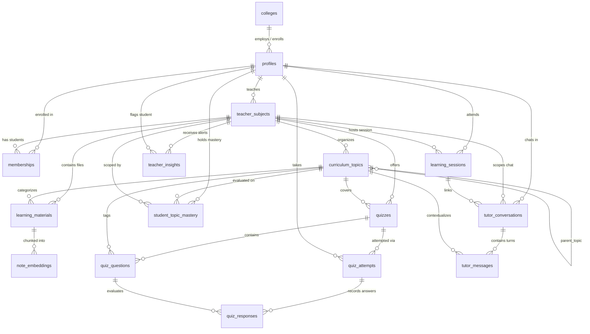

# ThinkFirst — Database Architecture & Schema Specification

**Project**: ThinkFirst  
**Team**: Odysseus  
**Track**: Agentic AI · RealmHack 2026  
**Document Version**: 2.0.0  
**Migration Script**: [`db/init.sql`](file:///c:/Users/Srinanth%20MV/Personal%20Projects/realm-hack/db/init.sql)  

---

## 1. Database Overview & Technology Stack

- **Engine**: PostgreSQL 15+ (Hosted on Supabase)
- **Extensions**:
  - `uuid-ossp` & `pgcrypto`: UUID primary key generation (`gen_random_uuid()`).
  - `vector` (`pgvector`): 768-dimensional vector embeddings and similarity search operators (`<=>`) for Gemini Embedding 2.
- **Core Principles**:
  - **Relational Integrity**: Strict foreign key constraints with cascading deletes where appropriate.
  - **Subject Multi-Tenancy**: Every educational entity links back to `teacher_subjects.id` (`teacher_subject_id`) to ensure complete isolation between classes.
  - **Granular Evidence Stream**: Individual question answers are logged in `quiz_responses` and Socratic dialogue in `tutor_messages`, allowing the Deterministic Mastery Engine to compute accurate topic-level scores in `student_topic_mastery`.

---

## 2. Entity Relationship Diagram (ERD)



---

## 3. Data Dictionary & Table Definitions

### 3.0 `colleges`
Institutions managed by platform Superadmins.

| Column | Type | Constraints | Description |
|---|---|---|---|
| `id` | `UUID` | `PRIMARY KEY DEFAULT gen_random_uuid()` | College ID |
| `name` | `TEXT` | `NOT NULL` | Institution name (e.g. "Rajiv Gandhi Institute of Technology") |
| `code` | `TEXT` | `NOT NULL, UNIQUE` | Unique code (e.g. "RIT-KTM") |
| `domain` | `TEXT` | `NULL` | Optional email domain (e.g. "rit.ac.in") |
| `created_at` | `TIMESTAMPTZ` | `NOT NULL DEFAULT NOW()` | Creation timestamp |

---

### 3.1 `profiles`
User profiles extending Supabase `auth.users`.

| Column | Type | Constraints | Description |
|---|---|---|---|
| `id` | `UUID` | `PRIMARY KEY`, references `auth.users(id) ON DELETE CASCADE` | Supabase user ID |
| `full_name` | `TEXT` | `NOT NULL` | Display name |
| `college` | `TEXT` | `NULL` | College name / institution string |
| `role` | `TEXT` | `NOT NULL`, `CHECK (role = ANY (ARRAY['admin'::text, 'teacher'::text, 'student'::text]))` | Application RBAC role |
| `created_at` | `TIMESTAMPTZ` | `NOT NULL DEFAULT now()` | Creation timestamp |
| `password` | `VARCHAR` | `NULL DEFAULT 'NULL'::character varying` | Optional credential hash |

---

### 3.2 `teacher_subjects`
Specific subject offering or class cohort taught by an instructor.

| Column | Type | Constraints | Description |
|---|---|---|---|
| `id` | `UUID` | `PRIMARY KEY DEFAULT gen_random_uuid()` | Subject offering ID |
| `teacher_id` | `UUID` | `NOT NULL`, references `profiles(id) ON DELETE RESTRICT` | Instructor ID |
| `subject` | `TEXT` | `NOT NULL` | Subject code or name (e.g. "Calculus") |
| `academic_year` | `TEXT` | `NOT NULL` | Term / year (e.g. "2025-2026") |
| `class_name` | `TEXT` | `NOT NULL` | Class or section (e.g. "Section B") |
| `created_at` | `TIMESTAMPTZ` | `NOT NULL DEFAULT now()` | Timestamp |
| **Constraint** | `UNIQUE(teacher_id, subject, academic_year, class_name)` | | Prevents duplicate offerings |

---

### 3.3 `memberships`
Enrollment relationship mapping students to teacher subject offerings.

| Column | Type | Constraints | Description |
|---|---|---|---|
| `teacher_subject_id` | `UUID` | `NOT NULL`, references `teacher_subjects(id) ON DELETE CASCADE` | Enrolled subject |
| `student_id` | `UUID` | `NOT NULL`, references `profiles(id) ON DELETE CASCADE` | Student ID |
| `joined_at` | `TIMESTAMPTZ` | `NOT NULL DEFAULT now()` | Enrollment date |
| **Primary Key** | `PRIMARY KEY (teacher_subject_id, student_id)` | | Composite PK |

---

### 3.4 `curriculum_topics`
Hierarchical topic tree for each subject offering.

| Column | Type | Constraints | Description |
|---|---|---|---|
| `id` | `UUID` | `PRIMARY KEY DEFAULT gen_random_uuid()` | Topic identifier |
| `teacher_subject_id` | `UUID` | `NOT NULL`, references `teacher_subjects(id) ON DELETE CASCADE` | Scoped subject |
| `parent_topic_id` | `UUID` | `NULL`, references `curriculum_topics(id) ON DELETE CASCADE` | Parent module/topic |
| `title` | `TEXT` | `NOT NULL` | Topic title |
| `description` | `TEXT` | `NULL` | Learning scope / summary |
| `node_type` | `TEXT` | `NOT NULL DEFAULT 'topic'::text, CHECK (node_type = ANY (ARRAY['module'::text, 'topic'::text, 'subtopic'::text]))` | Hierarchy tier |
| `created_at` | `TIMESTAMPTZ` | `NOT NULL DEFAULT now()` | Creation timestamp |

---

### 3.5 `learning_materials`
Metadata for teacher-uploaded handouts, lecture slide decks, and readings stored in Supabase Storage.

| Column | Type | Constraints | Description |
|---|---|---|---|
| `id` | `UUID` | `PRIMARY KEY DEFAULT gen_random_uuid()` | Material identifier |
| `teacher_subject_id` | `UUID` | `NOT NULL`, references `teacher_subjects(id) ON DELETE CASCADE` | Scoped subject |
| `curriculum_topic_id` | `UUID` | `NULL`, references `curriculum_topics(id) ON DELETE SET NULL` | Linked topic |
| `title` | `TEXT` | `NOT NULL` | Document title |
| `file_path` | `TEXT` | `NOT NULL` | Path in Supabase Storage bucket |
| `file_type` | `TEXT` | `NOT NULL` | Extension (e.g. "PDF", "DOCX", "PPTX") |
| `material_type` | `TEXT` | `NULL` | Category (e.g. "notes", "slides", "lab") |
| `processing_status` | `TEXT` | `NOT NULL DEFAULT 'pending', CHECK IN ('pending', 'processing', 'ready', 'failed')` | Ingestion status |
| `created_at` | `TIMESTAMPTZ` | `NOT NULL DEFAULT NOW()` | Upload timestamp |

---

### 3.6 `note_embeddings` (Vector Table)
Stores extracted plaintext chunks and 768-dimensional embeddings for Gemini-powered Socratic RAG.

| Column | Type | Constraints | Description |
|---|---|---|---|
| `id` | `UUID` | `PRIMARY KEY DEFAULT gen_random_uuid()` | Chunk identifier |
| `learning_material_id` | `UUID` | `NOT NULL`, references `learning_materials(id) ON DELETE CASCADE` | Source material file |
| `chunk_index` | `INTEGER` | `NOT NULL` | Sequence index |
| `content` | `TEXT` | `NOT NULL` | Plaintext content (~500 tokens) |
| `embedding` | `VECTOR(768)` | `NOT NULL` | Gemini Embedding 2 vector |
| `metadata` | `JSONB` | `NULL DEFAULT '{}'::jsonb` | Page numbers, headers |
| `created_at` | `TIMESTAMPTZ` | `NOT NULL DEFAULT NOW()` | Embedding timestamp |

---

### 3.7 `quizzes`
Quizzes created for a subject offering.

| Column | Type | Constraints | Description |
|---|---|---|---|
| `id` | `UUID` | `PRIMARY KEY DEFAULT gen_random_uuid()` | Quiz ID |
| `teacher_subject_id` | `UUID` | `NOT NULL`, references `teacher_subjects(id) ON DELETE CASCADE` | Scoped subject |
| `curriculum_topic_id` | `UUID` | `NULL`, references `curriculum_topics(id) ON DELETE SET NULL` | Associated topic |
| `created_by` | `UUID` | `NOT NULL`, references `profiles(id) ON DELETE RESTRICT` | Teacher creator |
| `title` | `TEXT` | `NOT NULL` | Quiz title |
| `description` | `TEXT` | `NULL` | Instructions |
| `difficulty` | `TEXT` | `NOT NULL, CHECK (difficulty = ANY (ARRAY['easy'::text, 'medium'::text, 'hard'::text]))` | Tier |
| `question_count` | `INTEGER` | `NOT NULL DEFAULT 0` | Total questions |
| `exam_duration` | `INTEGER` | `NOT NULL DEFAULT 30, CHECK (exam_duration > 0)` | Duration in minutes |
| `status` | `TEXT` | `NOT NULL DEFAULT 'draft'::text, CHECK (status = ANY (ARRAY['draft'::text, 'published'::text, 'archived'::text]))` | State |
| `created_at` | `TIMESTAMPTZ` | `NOT NULL DEFAULT now()` | Creation timestamp |

---

### 3.8 `quiz_questions`
Individual questions belonging to a quiz.

| Column | Type | Constraints | Description |
|---|---|---|---|
| `id` | `UUID` | `PRIMARY KEY DEFAULT gen_random_uuid()` | Question ID |
| `quiz_id` | `UUID` | `NOT NULL`, references `quizzes(id) ON DELETE CASCADE` | Parent quiz |
| `curriculum_topic_id` | `UUID` | `NULL`, references `curriculum_topics(id) ON DELETE SET NULL` | Tested topic |
| `question_text` | `TEXT` | `NOT NULL` | Prompt text |
| `question_type` | `TEXT` | `NOT NULL, CHECK (question_type = ANY (ARRAY['multiple_choice'::text, 'short_answer'::text, 'long_answer'::text]))` | Format |
| `options` | `JSONB` | `NULL` | Choices array for selection questions |
| `correct_answer` | `JSONB` | `NOT NULL` | Canonical correct answer / rubric |
| `explanation` | `TEXT` | `NULL` | Post-answer explanation |
| `difficulty` | `TEXT` | `NOT NULL, CHECK (difficulty = ANY (ARRAY['easy'::text, 'medium'::text, 'hard'::text]))` | Difficulty |
| `marks` | `NUMERIC` | `NOT NULL DEFAULT 1, CHECK (marks > 0)` | Maximum score |
| `position` | `INTEGER` | `NOT NULL DEFAULT 0` | Sequence ordering |
| `created_at` | `TIMESTAMPTZ` | `NOT NULL DEFAULT now()` | Creation timestamp |
| **Constraint** | `UNIQUE(quiz_id, "position")` | | Unique question position |

---

### 3.9 `quiz_attempts`
Records each student's attempt at a quiz.

| Column | Type | Constraints | Description |
|---|---|---|---|
| `id` | `UUID` | `PRIMARY KEY DEFAULT gen_random_uuid()` | Attempt identifier |
| `quiz_id` | `UUID` | `NOT NULL`, references `quizzes(id) ON DELETE CASCADE` | Quiz taken |
| `student_id` | `UUID` | `NOT NULL`, references `profiles(id) ON DELETE CASCADE` | Student ID |
| `score` | `NUMERIC` | `NULL, CHECK (score IS NULL OR score >= 0)` | Total marks earned |
| `max_score` | `NUMERIC` | `NULL, CHECK (max_score IS NULL OR max_score >= 0)` | Total available marks |
| `status` | `TEXT` | `NOT NULL DEFAULT 'in_progress'::text, CHECK (status = ANY (ARRAY['in_progress'::text, 'submitted'::text, 'graded'::text]))` | Attempt state |
| `started_at` | `TIMESTAMPTZ` | `NOT NULL DEFAULT now()` | Start time |
| `submitted_at` | `TIMESTAMPTZ` | `NULL` | Submission time |
| `graded_at` | `TIMESTAMPTZ` | `NULL` | Evaluation completion time |
| **Constraint** | `CHECK (score IS NULL OR max_score IS NULL OR score <= max_score)` | | Score bounds validation |
| **Constraint** | `UNIQUE(quiz_id, student_id)` | | Exactly one attempt record per student per quiz |

---

### 3.10 `quiz_responses`
Stores granular student answers for each question (the historical evidence stream).

| Column | Type | Constraints | Description |
|---|---|---|---|
| `id` | `UUID` | `PRIMARY KEY DEFAULT gen_random_uuid()` | Response ID |
| `quiz_attempt_id` | `UUID` | `NOT NULL`, references `quiz_attempts(id) ON DELETE CASCADE` | Parent attempt |
| `question_id` | `UUID` | `NOT NULL`, references `quiz_questions(id) ON DELETE CASCADE` | Question answered |
| `student_answer` | `JSONB` | `NOT NULL` | Selected choices or free-form text |
| `is_correct` | `BOOLEAN` | `NULL` | Correctness evaluation |
| `marks_awarded` | `NUMERIC` | `NULL, CHECK (marks_awarded IS NULL OR marks_awarded >= 0)` | Points granted |
| `feedback` | `TEXT` | `NULL` | Socratic evaluator feedback |
| `answered_at` | `TIMESTAMPTZ` | `NOT NULL DEFAULT now()` | Answer timestamp |
| **Constraint** | `UNIQUE(quiz_attempt_id, question_id)` | | One response per question attempt |

---

### 3.11 `student_topic_mastery`
Stores canonical student mastery scores per topic within each subject class.

| Column | Type | Constraints | Description |
|---|---|---|---|
| `student_id` | `UUID` | `NOT NULL`, references `profiles(id) ON DELETE CASCADE` | Student ID |
| `teacher_subject_id` | `UUID` | `NOT NULL`, references `teacher_subjects(id) ON DELETE CASCADE` | Subject class |
| `curriculum_topic_id` | `UUID` | `NOT NULL`, references `curriculum_topics(id) ON DELETE CASCADE` | Tested topic |
| `mastery_score` | `NUMERIC` | `NOT NULL, CHECK (mastery_score >= 0 AND mastery_score <= 1)` | Mastery estimate $[0.0, 1.0]$ |
| `confidence` | `NUMERIC` | `NOT NULL, CHECK (confidence >= 0 AND confidence <= 1)` | Confidence $[0.0, 1.0]$ |
| `last_assessed_at` | `TIMESTAMPTZ` | `NULL` | Timestamp of latest evaluation |
| `updated_at` | `TIMESTAMPTZ` | `NOT NULL DEFAULT now()` | Timestamp of last calculation |
| **Primary Key** | `PRIMARY KEY (student_id, teacher_subject_id, curriculum_topic_id)` | | Unique topic per student per class |

---

### 3.12 `student_mastery_history`
Chronological audit log tracking mastery progression over time per student and topic.

| Column | Type | Constraints | Description |
|---|---|---|---|
| `id` | `UUID` | `PRIMARY KEY DEFAULT gen_random_uuid()` | History event ID |
| `student_id` | `UUID` | `NOT NULL`, references `profiles(id) ON DELETE CASCADE` | Student ID |
| `teacher_subject_id` | `UUID` | `NOT NULL`, references `teacher_subjects(id) ON DELETE CASCADE` | Subject class |
| `curriculum_topic_id` | `UUID` | `NOT NULL`, references `curriculum_topics(id) ON DELETE CASCADE` | Assessed topic |
| `mastery_score` | `NUMERIC` | `NOT NULL, CHECK (mastery_score >= 0 AND mastery_score <= 1)` | Calculated score |
| `confidence` | `NUMERIC` | `NOT NULL, CHECK (confidence >= 0 AND confidence <= 1)` | Assessment confidence |
| `assessment_source` | `TEXT` | `NOT NULL, CHECK (assessment_source = ANY (ARRAY['quiz'::text, 'ai_tutor'::text]))` | Evaluation channel |
| `assessed_at` | `TIMESTAMPTZ` | `NOT NULL DEFAULT now()` | Event timestamp |
| `source_quiz_id` | `UUID` | `NULL`, references `quizzes(id) ON DELETE SET NULL` | Source quiz ID if applicable |

---

### 3.13 `learning_sessions`
Records tutoring or independent learning study blocks.

| Column | Type | Constraints | Description |
|---|---|---|---|
| `id` | `UUID` | `PRIMARY KEY DEFAULT gen_random_uuid()` | Session ID |
| `student_id` | `UUID` | `NOT NULL`, references `profiles(id) ON DELETE CASCADE` | Student ID |
| `teacher_subject_id` | `UUID` | `NOT NULL`, references `teacher_subjects(id) ON DELETE CASCADE` | Subject class |
| `started_at` | `TIMESTAMPTZ` | `NOT NULL DEFAULT now()` | Start timestamp |
| `ended_at` | `TIMESTAMPTZ` | `NULL` | End timestamp |
| `session_type` | `TEXT` | `NOT NULL, CHECK (session_type = ANY (ARRAY['ai_tutor'::text, 'revision'::text, 'practice'::text]))` | Study modality |
| **Constraint** | `CHECK (ended_at IS NULL OR ended_at >= started_at)` | | Valid duration constraint |
| `session_type` | `TEXT` | `NOT NULL, CHECK (session_type IN ('ai_tutor', 'revision', 'practice'))` | Study modality |

---

### 3.13 `tutor_conversations`
Persistent conversation threads between student and AI Tutor scoped to a subject.

| Column | Type | Constraints | Description |
|---|---|---|---|
| `id` | `UUID` | `PRIMARY KEY DEFAULT gen_random_uuid()` | Conversation ID |
| `student_id` | `UUID` | `NOT NULL`, references `profiles(id) ON DELETE CASCADE` | Student ID |
| `teacher_subject_id` | `UUID` | `NOT NULL`, references `teacher_subjects(id) ON DELETE CASCADE` | Scoped subject class |
| `learning_session_id` | `UUID` | `NULL`, references `learning_sessions(id) ON DELETE SET NULL` | Parent session |
| `title` | `TEXT` | `NULL` | Descriptive topic title |
| `created_at` | `TIMESTAMPTZ` | `NOT NULL DEFAULT NOW()` | Conversation start |
| `updated_at` | `TIMESTAMPTZ` | `NOT NULL DEFAULT NOW()` | Last message time |

---

### 3.14 `tutor_messages`
Individual dialogue turns exchanged in a Socratic conversation.

| Column | Type | Constraints | Description |
|---|---|---|---|
| `id` | `UUID` | `PRIMARY KEY DEFAULT gen_random_uuid()` | Message ID |
| `conversation_id` | `UUID` | `NOT NULL`, references `tutor_conversations(id) ON DELETE CASCADE` | Conversation container |
| `role` | `TEXT` | `NOT NULL, CHECK (role IN ('user', 'assistant', 'system'))` | Message author |
| `content` | `TEXT` | `NOT NULL` | Dialogue text |
| `curriculum_topic_id` | `UUID` | `NULL`, references `curriculum_topics(id) ON DELETE SET NULL` | Focus concept |
| `created_at` | `TIMESTAMPTZ` | `NOT NULL DEFAULT NOW()` | Timestamp |

---

### 3.15 `teacher_insights`
AI-generated diagnostic signals for teachers based on aggregated student evidence.

| Column | Type | Constraints | Description |
|---|---|---|---|
| `id` | `UUID` | `PRIMARY KEY DEFAULT gen_random_uuid()` | Insight ID |
| `teacher_subject_id` | `UUID` | `NOT NULL`, references `teacher_subjects(id) ON DELETE CASCADE` | Subject class |
| `insight_type` | `TEXT` | `NOT NULL, CHECK (insight_type IN ('struggling_topic', 'student_needs_support', 'class_progress'))` | Diagnostic category |
| `title` | `TEXT` | `NOT NULL` | Summary headline |
| `description` | `TEXT` | `NOT NULL` | Pedagogical explanation |
| `curriculum_topic_id` | `UUID` | `NULL`, references `curriculum_topics(id) ON DELETE SET NULL` | Impacted topic |
| `student_id` | `UUID` | `NULL`, references `profiles(id) ON DELETE CASCADE` | Flagged student |
| `evidence` | `JSONB` | `NULL` | Supporting stats / response traces |
| `status` | `TEXT` | `NOT NULL DEFAULT 'active', CHECK (status IN ('active', 'dismissed', 'resolved'))` | Insight state |
| `created_at` | `TIMESTAMPTZ` | `NOT NULL DEFAULT NOW()` | Generation timestamp |

---

## 4. Subject-Scoped Vector Similarity Query

```sql
SELECT 
  ne.id,
  ne.learning_material_id,
  ne.chunk_index,
  ne.content,
  1 - (ne.embedding <=> $1) AS similarity_score
FROM public.note_embeddings ne
JOIN public.learning_materials lm ON lm.id = ne.learning_material_id
WHERE lm.teacher_subject_id = $2
  AND 1 - (ne.embedding <=> $1) > 0.65
ORDER BY ne.embedding <=> $1
LIMIT 5;
```
